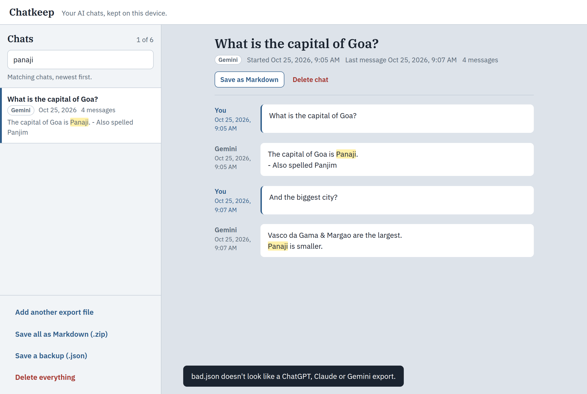

# Chatkeep

A local copy of your AI chats. Give it the export file from ChatGPT, Claude or Gemini and you get a readable, searchable archive that lives in your browser and never leaves your device.

Built in answer to a request on r/SomebodyMakeThis (23 Oct 2026) for a way to keep your own copy of your conversations with AI services, in the same fortnight Hacker News was full of threads about chat services training on user history.



## What it does

- **Reads the official exports.** Drop the `.zip` or `.json` you get from ChatGPT (`conversations.json`), Claude (`conversations.json`) or Gemini via Google Takeout (`MyActivity.json`). Zips are unpacked in the browser; you don't need to extract them first.
- **Makes them readable.** Each chat becomes a thread of "You" and the assistant, with dates. ChatGPT exports keep every regenerated branch; Chatkeep shows the branch you actually saw.
- **Searches every message.** Type a word and see matching chats with a snippet; matches are highlighted in the chat too.
- **Exports to plain files.** One chat as Markdown, or all of them as a zip of Markdown files sorted by service. A JSON backup moves the whole archive to another browser.
- **Adds, never duplicates.** Import a newer export and only the chats you didn't have are added.
- **Stays private by construction.** Everything is stored in IndexedDB in your browser. The page carries a Content Security Policy with `connect-src 'none'`, so it cannot make a network request even if it wanted to. It also works offline and installs as an app.

## Use it

Live: https://lnr-7.github.io/chatkeep/

### Getting your export file

- **ChatGPT:** Settings, then Data controls, then Export data. The link arrives by email as a `.zip`.
- **Claude:** Settings, then Privacy, then Export data. The `.zip` arrives by email.
- **Gemini:** Go to [takeout.google.com](https://takeout.google.com), deselect all, pick only *My Activity*, choose *Gemini Apps* and the **JSON** format, then download.

Menus move around; if these paths are stale, look for "export" in the service's settings.

## Run it yourself

Plain HTML, CSS and JavaScript, no build step.

```sh
git clone https://github.com/lnr-7/chatkeep.git
cd chatkeep
python3 -m http.server 8080
# open http://localhost:8080
```

Tests cover the three parsers, the zip reader/writer and the Markdown export:

```sh
node --test
```

## How it is put together

| File | Role |
|---|---|
| `importers.js` | Detects the export format and turns ChatGPT, Claude and Gemini files into one shape |
| `zip.js` | Minimal zip reader (store + deflate via `DecompressionStream`) and writer (store only) |
| `markdown.js` | Markdown export, file naming, search |
| `db.js` | IndexedDB wrapper |
| `app.js` | Screens: welcome, list with search, reading view, import and export |
| `sw.js` | Service worker for offline use |
| `tests/` | `node --test` suite with fixture files for each format |

## Limits

- Gemini's Takeout has no conversation ids, so prompts less than 30 minutes apart are grouped as one chat. It is a best effort.
- Images and files attached to chats are not kept; a `[image]` marker is left in their place.
- Zips over 4 GB (zip64) are not supported.
- Storage is per browser. Use "Save a backup" to move it.

## License

MIT for the code (see `LICENSE`). IBM Plex fonts are under the SIL Open Font License 1.1.
